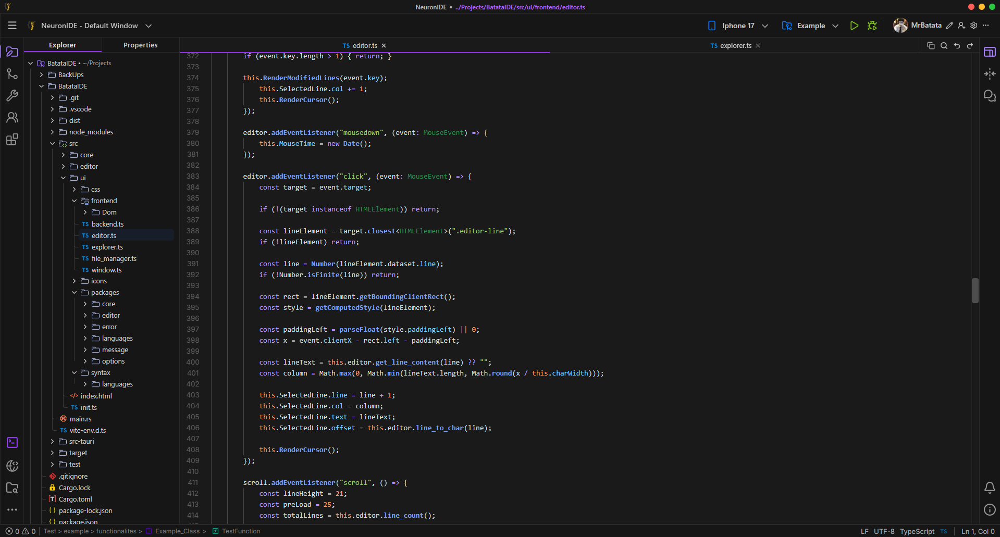
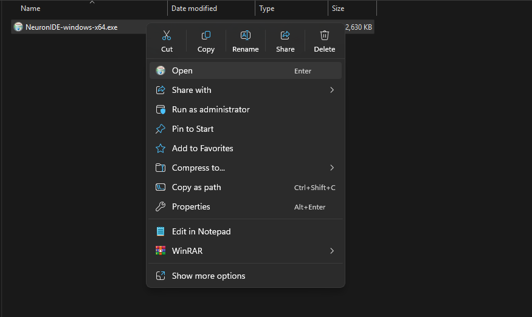

# NeuronIDE

A free/open source lightweight and resource-efficient IDE made for heavy work while being fully beginner-friendly. The IDE is cross-platform, supporting Windows, linux and mac. With Android and IOS releases coming soon.


Comes with all the development tools you know and love and will boost your work productivity, profiler, debugger, UI viewer. Much more coming soon.

NeuronIDE fully respects the user's privacy, it never collects any data and your usage will never be sold.

> Warning: This IDE is still under developement ( Pre Alpha state ). This is not meant to be used at the current time! This is not meant to be used or installed

## Features
NeuronIDE comes with multiple built-in tools made and designed to boost your development productivity and simplify your workflow.


- **Beginner-friendly**: NeuronIDE is simple to use for new developers. Making it a great tool for anyone learning Coding/programming.

- **GitHub Integration:** Connect your GitHub account directly to NeuronIDE to browse, access, and select your repositories without leaving the IDE. Easily bring your projects into your development environment and manage your workflow in one place! You can use git directly to control your repo.

- ** Official plugin support **: Extended plugins that connect to the IDE via the offical APIs. Check our logs for built in [supported apis](./docs/apis.md)

- **Customizations & Settings**: Adapt your development environment to your personal workflow with deep/simple to use settings.

- **Updates**: Each update includes new features to improve the usage experience. From new tools that can be used to make your workflow easier to optimizations that make the IDE perform better.

- **Support & Bug Reports:** If you encounter a bug, unexpected behavior, or any other issue while using NeuronIDE, please report it through our [GitHub Issues](https://github.com/mrbatataprog/NeuronIDE/issues). Your feedback helps us identify problems and improve the project.

## Resources - Compatibility
NeuronIDE designed with the goal of being efficient and uses less resoures possible. Including:

- **Cross-Platform compatibility **: You can run NeuronIDE smoothly on any operating system via web view, using [Tauri backend](). Support for Phones coming soon for both Android and coming for IOS soon.

- ** Resource Efficiency**: Being efficient to use as few resources as possible and causes no performance loss. Uses as little memory as possible under heavy load and mainly focuses on GPU rendering.

- **Heavy Workloads**: Made for small to large codebases with no noticeable performance issues or high memory usage.

More optimizations coming soon for boosting performance and supporting even more devices!


## Getting started & Installion
Getting started with NeuronIDE Installation. Follow the installation steps. in case of an error caused during installation, please submit your error to [GitHub Issues](https://github.com/mrbatataprog/NeuronIDE/issues).


Supported operating systems for this current version is: Windows. Coming for other operating systems soon, as intended! IDE is able to work on low-end devices too.


- **Download the installer**: Install the installer file from: [Installion Link]() and select your OS and version. To select a older version installer via [All versions]().
- **Open the installer**: After the installion. Open the file and continue with the installation:



- **Open the IDE**: And open new file.


## Developement & Constrbuting
NeuronIDE is developed using an architecture combining web technologies and native system programming via the Rust Programming language, Used to handle things such as Tauri for the webview and file operations, etc. Keeping performance and user experience stable using `multithreading`. The application has two different parts. Frontend and backend.


Frontend that stands on full UI management using TS, mainly with HTML/CSS and the use of Rust via `WebAssembly` for storing memory-related data and managing everything else to keep up the performance high.


The backend stands on full file operations and communicates with the frontend via `ICP` calls. Rust is also used for managing the webview using the `Tauri Framework`.


### Development Requirements
---
In case you want to get into contributing into the project. Make sure you have:
- Git ( Optional ).
- Npm/node.js to run the frontend. Or a supported alternative runtime for the webview.
- Rust toolchain (RustC and cargo). Install the Tauri framework via:
```bash
cargo install tauri-cli # Installation for Rust


npm install -D @tauri-apps/cli # Installion for NPM
npm install @tauri-apps/api # Installion for APIs too


npm install -D vite typescript # Optional. Install vite for hot reload for the UI
```
```bash
cargo tauri dev # To run in development mode
cargo tauri build # To build the release mode
```


> **Help**: For full installion for the development **tools**. Please check out our documentation [Developing & Contributing]()
### Development Guidelines
---


1. **Frontend & Backend Separation** Keep the frontend only for managing any UI related. And the backend for file operations. Make sure to use optimized code and do not rely on the DOM.
2. ** Preferred Languages** Use TypeScript/Rust mainly. JS is not preferred.
3. **Performance & Memory Management** Keep the performance-critical operations in Rust where appropriate. Same with storing in memory for many elements using something like HashMap/HashSets/Arrays.
4. **Multithreading** Avoid blocking the main thread for the UI. Always keep it on OS multithreading.
5. **Testing & Contributions** Test changes and submit a request for contribution.


6. **UI Compatibility** Ensure UI changes work across different screen sizes and display scaling settings. in case of changing anything UI related.


> **Info:** All submitted code will be reviewed/Test. It may takes time before accepting your request. Using AI is not allowed for coding.

### Performance & Compatibility
---
NeuronIDE aims mainly responsible for **older-devices** with no bloat. Contributors are encouraged to test their changes under limited CPU and memory conditions, as well as on different display resolutions and supported operating systems.


### Contributing
---
1. **Fork the repository**.
2. **Create a branch for your changes**.
3. **Implement and test your changes**.
4. **Commit your work with descriptive commit messages**. Make sure to include documentation about all changes.
5. **Submit a Pull Request describing the changes and any relevant testing performed.**


## Licences & Usage
NeuronIDE uses MIT licences, which allow you to copy/use or modify the code without any legal issues. You cannot use the same IDE name for your application.


> Happy coding! And Good luck on your jerny!

|| Version: Pre-Alpha 1.9.0 Release date: 11/18/2026